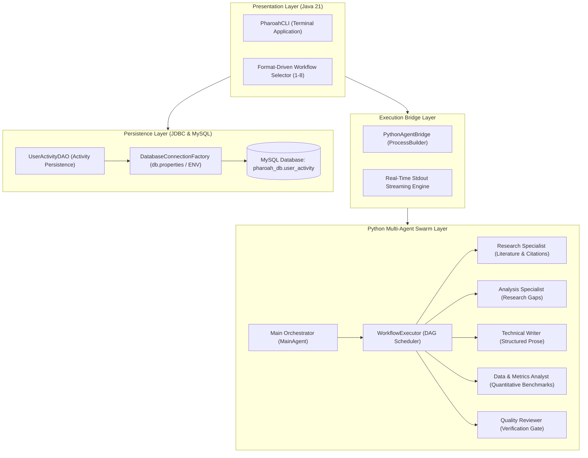

# 🏛️ PHAROAH: System Architecture & Technical Specifications

**Architecture Style:** Hybrid Layered Architecture (Terminal-First Java UI + Python Swarm)  
**Database Engine:** MySQL 8.0 (InnoDB) with SQLite fallback  
**Platforms:** Java 21 LTS + Python 3.8+

---

## 1. Architectural Layers & Multi-Agent Swarm

PHAROAH combines a high-performance Java terminal runtime with a visible Python multi-agent swarm:



---

## 2. The 5-Step Format-Driven Pipeline

1. **Step 1: Format Resolution**: Identifies document requirements (e.g., IEEE Research Paper, Tech Docs, Blog).
2. **Step 2: Topic Scoping**: Registers active topic context.
3. **Step 3: Section Decomposition**: Displays ordered section graph; user selects single, multiple, or all sections.
4. **Step 4: Priority Scheduling**: Weighted priority queue (`HIGH`, `MEDIUM`, `LOW`) resolves dependency order (e.g., Literature Review before Research Gap).
5. **Step 5: Agent Swarm Execution & Review**:
   - Dispatches tasks to specialized agents.
   - Live streaming displays `[WAITING]`, `[RUNNING]`, thinking indicators, word count statistics.
   - Quality Reviewer evaluates outputs against quality thresholds (e.g. 94/100).
   - Generates consolidated markdown artifact in `outputs/`.
   - Records persistent audit row in MySQL table `user_activity`.

---

## 3. Database Schema: `user_activity`

The simplified database audit table allows immediate evaluation in **MySQL Workbench**:

```sql
CREATE TABLE IF NOT EXISTS user_activity (
    activity_id INT AUTO_INCREMENT PRIMARY KEY,
    user_name VARCHAR(100) NOT NULL,
    topic VARCHAR(255) NOT NULL,
    workflow_type VARCHAR(100) NOT NULL,
    sections_worked TEXT NOT NULL,
    agents_used TEXT NOT NULL,
    status VARCHAR(50) NOT NULL DEFAULT 'COMPLETED',
    created_at TIMESTAMP DEFAULT CURRENT_TIMESTAMP
) ENGINE=InnoDB;
```

---

## 4. Team Responsibilities

- **VARIJ CHAUHAN**: Architecture, Java CLI, ProcessBuilder Subprocess Bridge, Concurrency & Stream Analytics.
- **ASHUTOSH**: Python Multi-Agent Swarm, BaseAgent, Specialized Swarm Agents, Format Workflows, Execution Engine.
- **SANCHIT**: Database Persistence, JDBC Connection Pooling, MySQL Schema, UserActivity DAO, Knowledge Management.
