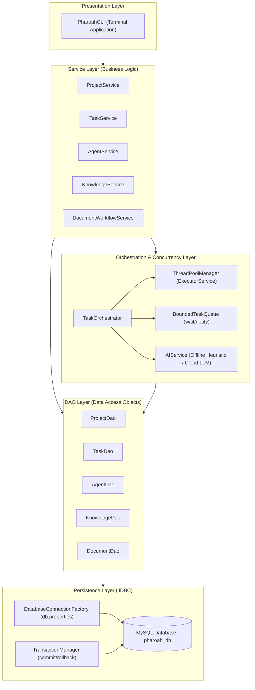
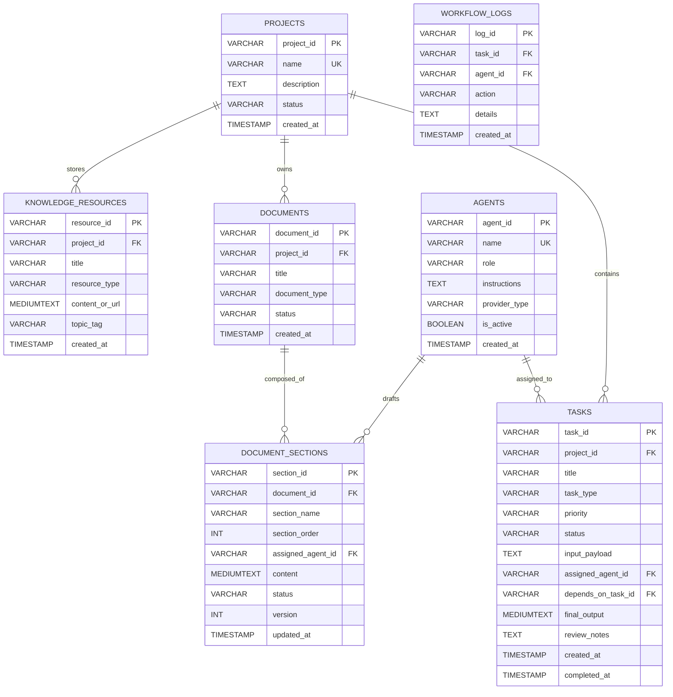
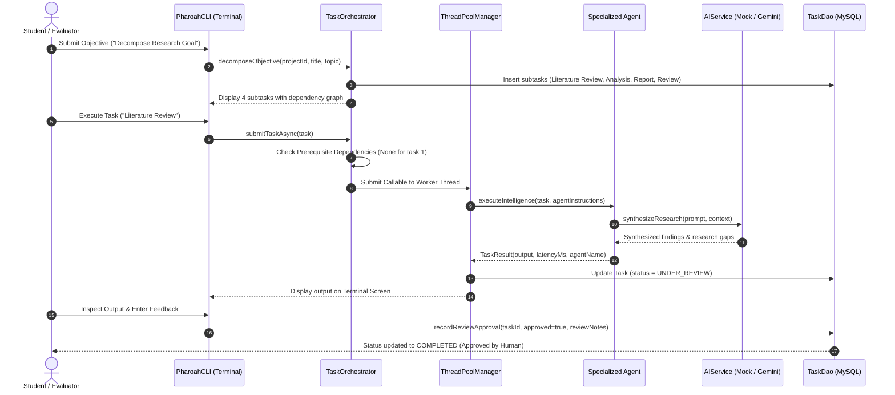

# 🏛️ PHAROAH: System Architecture & Technical Specifications

**Architecture Style:** Layered Hexagonal Architecture (Terminal-First)  
**Database Engine:** MySQL 8.0 (InnoDB) with SQLite fallback  
**Platform:** Java 21 LTS

---

## 1. Architectural Layers

PHAROAH follows a clean 4-tier layered architecture:

---

## 2. Relational Database Schema (MySQL 8.0)

---

## 3. Multi-Agent Orchestration Flow

---

## 4. Document Workflow Engine

1. **Template Generation:** When a user creates an *Academic Research Paper*, *Technical Blog*, *Technical Documentation*, or *Business Proposal*, `DocumentWorkflowService` automatically creates the corresponding standard sections.
2. **Independent Section Drafting:** Individual sections are assigned to specialized agents (e.g. `Abstract` to `WRITING_AGENT`, `Methodology` to `RESEARCH_AGENT`, `Architecture` to `DOCUMENTATION_AGENT`).
3. **Section-Level Review & Versioning:** Each section maintains an independent `version` counter and status (`PENDING` $\to$ `DRAFTED` $\to$ `UNDER_REVIEW` $\to$ `APPROVED`).
4. **Final Compilation:** Calling `compileDocument()` reads all approved sections in their defined `section_order` and concatenates them into a unified Markdown document.
